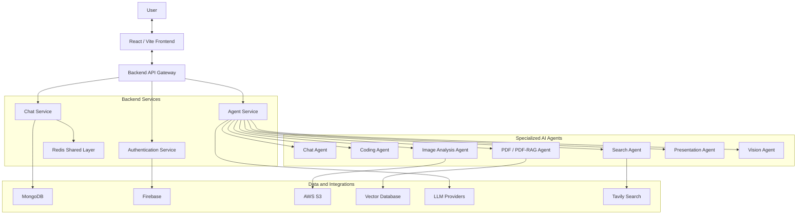

# AmeekAI

### An Intelligent Multi-Agent AI Platform

**AmeekAI** is a modular, AI-powered multi-agent platform designed to bring multiple specialized artificial intelligence capabilities into one unified workspace.

Rather than relying on a single general-purpose AI workflow, AmeekAI is built around specialized agents that handle different categories of tasks, including conversational assistance, coding, document intelligence, image analysis, research, and information retrieval.

The platform follows a service-oriented architecture, separating the frontend, backend gateway, authentication, chat functionality, and AI agent services.

**One platform. Multiple specialized agents. One intelligent experience.**

---

## Overview

Artificial intelligence is becoming increasingly useful across software development, research, productivity, and information processing. However, using separate AI applications for different tasks can create fragmented workflows.

AmeekAI aims to bring these capabilities together through a centralized multi-agent architecture.

The platform is designed to:

- Provide a unified interface for interacting with AI.
- Organize specialized agents around different tasks.
- Process different types of user input.
- Support conversational AI workflows.
- Integrate external AI models and services.
- Maintain a modular architecture that can accommodate additional agents.

Each specialized agent has a particular responsibility, allowing the platform to organize AI functionality into more manageable components.

## The Problem AmeekAI Solves

Many AI applications focus on a single capability or provide different tools through disconnected interfaces.

This creates several challenges:

- Switching between different AI applications for different tasks.
- Repeating context when moving between tools.
- Managing separate workflows for coding, research, and document processing.
- Limited flexibility when extending AI functionality.
- Difficulty organizing multiple AI capabilities within one application.

AmeekAI addresses these challenges through a centralized multi-agent approach.

## Project Vision

The vision behind AmeekAI is to build an extensible AI ecosystem where specialized agents collaborate through a common application architecture.

The long-term objectives include:

- A unified AI workspace.
- Specialized agents for different categories of tasks.
- Modular agent development.
- Flexible AI model integrations.
- Context-aware conversational workflows.
- Improved document and multimodal processing.
- A scalable foundation for expanding AI capabilities.

## Core Capabilities

The project includes specialized agent components covering several AI use cases.

| Agent / Capability | Purpose |
|---|---|
| Chat Agent | Conversational AI interactions |
| Coding Agent | Programming-related assistance |
| Image Analysis Agent | Understanding and analyzing images |
| PDF Agent | Processing PDF documents |
| PDF-RAG Agent | Retrieval-augmented question answering over documents |
| Presentation Agent | PowerPoint presentation generation workflows |
| Search Agent | Information retrieval and web research |
| Vision Agent | Visual input processing |
| Title Generation | Generating titles for conversations |

*The availability and functionality of individual capabilities depend on their implementation and configuration.*

## Multi-Agent Architecture

AmeekAI uses a modular backend structure to separate application responsibilities.

Instead of placing all AI functionality inside one large service, the architecture organizes the application into dedicated components.

### Architecture Diagram



This diagram represents the intended service and integration relationships. Actual connections depend on the implementation and configuration of each component.

### Architectural Principles

**Separation of concerns**

Different application responsibilities are organized into dedicated services.

**Specialized agents**

Each agent focuses on a particular category of AI tasks.

**Service modularity**

Individual services can be developed and maintained independently.

**Integration flexibility**

The architecture accommodates external AI models, databases, and supporting services.

---

## Technology Stack

AmeekAI uses a combination of frontend, backend, database, infrastructure, and AI technologies.

### Frontend

| Technology | Purpose |
|---|---|
| React | Component-based user interface |
| Vite | Frontend development and build tooling |
| JavaScript | Application development |

### Backend

| Technology | Purpose |
|---|---|
| Node.js | Server-side JavaScript runtime |
| Express.js | Backend API and service framework |
| REST APIs | Communication between application components |

### Database and Storage

| Technology | Purpose |
|---|---|
| MongoDB | Application data storage |
| Redis | Shared caching and data layer |
| AWS S3 | Object and file storage |
| Vector Database | Vector-based retrieval and semantic search |

### Authentication and Integrations

| Technology | Purpose |
|---|---|
| Firebase | Authentication-related integration |
| Tavily | Search and research integration |
| LLM Providers | AI model capabilities |

### Infrastructure and Development Tools

| Technology | Purpose |
|---|---|
| Docker | Containerization |
| Docker Compose | Multi-service development orchestration |
| Git | Version control |

*The technologies above reflect the project's previously documented architecture and integrations. Exact versions, provider names, and active configurations should be verified against the repository manifests and environment files.*

---

## Project Structure

The repository follows a monorepo-style organization, keeping the frontend and backend components within one repository.

```text
ameek-ai/
│
├── backend/
│   │
│   ├── gateway/
│   │   └── API gateway and request routing
│   │
│   ├── services/
│   │   ├── agent/
│   │   │   └── Specialized AI agent functionality
│   │   │
│   │   ├── auth/
│   │   │   └── Authentication functionality
│   │   │
│   │   └── chat/
│   │       └── Conversational functionality
│   │
│   └── shared/
│       └── redis/
│           └── Shared Redis functionality
│
├── frontend/
│   └── ameek-ai/
│       └── React / Vite application
│
├── .gitignore
└── README.md
```

Additional configuration, Docker files, agent modules, and supporting resources are maintained within their respective application directories.

## Getting Started

### Prerequisites

Before starting development, make sure you have:

- Git
- Node.js
- npm
- Docker and Docker Compose (if using the containerized workflow)
- Access to the external services required by your configuration

### 1. Clone the repository

```bash
git clone https://github.com/realsameek-collab/ameek-ai.git
```

### 2. Navigate into the project

```bash
cd ameek-ai
```

### 3. Install frontend dependencies

Navigate to the frontend application:

```bash
cd frontend/ameek-ai
npm install
```

### 4. Install backend dependencies

Install dependencies in the gateway and each independently managed backend service according to their respective package manifests.

Check each service's `package.json` before running installation commands.

### 5. Configure environment variables

AmeekAI integrates with external services that may require credentials and configuration.

Depending on the enabled functionality, configuration may include:

- Database connection settings.
- Firebase credentials and configuration.
- Redis connection details.
- Object storage credentials.
- AI model provider credentials.
- Search provider credentials.
- Vector database configuration.

Use the provided example environment files as the source of truth.

Never commit private credentials or API keys.

### 6. Start the application

Use the development scripts defined in the individual frontend and backend package manifests.

For the containerized workflow, refer to the repository's Docker Compose configuration.

---

## Understanding the AI Agent System

One of the central ideas behind AmeekAI is specialized agent functionality.

### 1. Conversational AI

The conversational agent provides a natural-language interface for interacting with AI.

Its purpose is to support general questions, explanations, and conversational workflows.

### 2. Coding Agent

The coding agent focuses on programming-related tasks.

Its intended use cases include:

- Understanding programming concepts.
- Generating code.
- Explaining code.
- Assisting with debugging.
- Supporting software development workflows.

### 3. Document Intelligence

AmeekAI includes PDF-related agent components.

These are designed around document processing and retrieval-based question answering.

**RAG (Retrieval-Augmented Generation)** combines information retrieval with language model generation. It allows an AI workflow to retrieve relevant document content before generating an answer.

### 4. Image Analysis and Vision

Image-related agents provide functionality for working with visual information.

Potential use cases include:

- Image understanding.
- Visual question answering.
- Image content analysis.
- Extracting useful information from visual inputs.

### 5. Search and Research

The search agent is designed to support information retrieval and research workflows.

Tavily is part of the project's search integration ecosystem.

### 6. Presentation Generation

The presentation agent is intended for PowerPoint-related generation workflows.

### 7. Title Generation

The title-generation component supports automatically creating meaningful titles for conversations.

---

## API and Service Architecture

The backend is organized around dedicated services.

| Service | Responsibility |
|---|---|
| Gateway | Central API entry point and request routing |
| Agent Service | AI agent functionality |
| Authentication Service | User authentication functionality |
| Chat Service | Conversational application functionality |
| Shared Redis | Shared Redis infrastructure |

The exact API routes, request formats, response schemas, and authentication requirements should be referenced from the backend implementation.

## Security Considerations

Security is an important part of building an AI-powered application.

Important areas include:

- Secure management of API credentials.
- Authentication and authorization.
- Server-side input validation.
- Secure file handling.
- Database access controls.
- Protection of AI provider credentials.
- Appropriate restrictions on agent capabilities.
- Safe handling of uploaded documents and images.
- Dependency maintenance and security updates.

AI agents that interact with external tools or process user-provided content should also be designed with appropriate permission boundaries.

## Troubleshooting

| Problem | Things to Check |
|---|---|
| Frontend dependencies fail | Node.js version and package manager |
| Backend service fails | Service configuration and dependencies |
| Database connection fails | Database URL and network access |
| Redis connection fails | Redis service and connection settings |
| AI requests fail | Model provider credentials and configuration |
| Search functionality fails | Search provider configuration |
| File processing fails | Storage permissions and file configuration |

For additional troubleshooting, inspect the relevant service logs.

## Roadmap

Potential future development directions:

- [ ] Expand the specialized agent ecosystem.
- [ ] Improve coordination between agents.
- [ ] Enhance multi-agent orchestration.
- [ ] Improve conversational context management.
- [ ] Expand supported AI model integrations.
- [ ] Enhance document intelligence and RAG workflows.
- [ ] Improve multimodal AI capabilities.
- [ ] Expand testing and monitoring.
- [ ] Improve developer documentation.
- [ ] Enhance security and permission management.

These items represent development directions, not a statement that the features are already implemented.

## Contributing

Contributions, suggestions, and feedback are welcome.

To contribute:

1. Fork the repository.
2. Create a feature branch.
3. Make your changes.
4. Test your implementation.
5. Submit a pull request with a clear explanation.

For substantial architectural changes, discuss the proposed approach before implementation.

## License

Refer to the repository's license file for the applicable licensing terms.

If no license is present, licensing and redistribution permissions should be established before treating the project as open source.

---

## Author

**Abdullah Ashfaq**

GitHub: [@realsameek-collab](https://github.com/realsameek-collab)

Project Repository: [AmeekAI](https://github.com/realsameek-collab/ameek-ai)

---

<p align="center">

**AmeekAI**

*One intelligent platform. Multiple specialized agents. Endless possibilities.*

</p>
